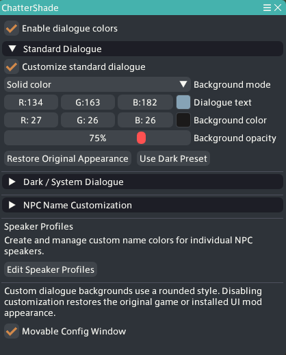
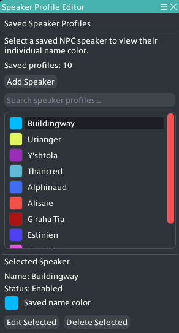

# ChatterShade

ChatterShade is a Dalamud plugin for Final Fantasy XIV that allows players to customize NPC dialogue text, speaker name colors, and dialogue backgrounds.

The plugin gives players more control over how dialogue appears in-game, whether that's to improve readability or simply change the appearance to suit their preferences.

## Features

### Dialogue Customization
- Customize Standard Dialogue and Dark/System Dialogue independently.
- Change dialogue text colors.
- Keep the original background texture or use a rounded solid-color background.
- Adjust background colors and opacity.
- Restore the original appearance or apply a dark preset.

### NPC Name Customization
- Set a global NPC speaker name color separately from dialogue text.
- Create individual speaker profiles with their own custom name colors.
- Add, edit, delete, enable/disable, and search saved profiles.
- Save settings and speaker profiles between sessions.

### Additional Features
- Supports regular NPC dialogue and cutscenes.
- Supports conversations involving multiple speakers and multi-line dialogue.
- Includes an optional movable configuration window.

## Configuration

Use `/cshade` in-game to open the configuration window.

From here, you can adjust dialogue text colors, backgrounds, opacity, and NPC name customization.

## Speaker Profiles

Speaker Profiles allow you to give individual NPCs their own name colors instead of using the same global color for everyone.

To create a profile:

1. Open ChatterShade using `/cshade`.
2. Click **Edit Speaker Profiles**.
3. Click **Add Speaker**.
4. Enter the NPC's name as it appears in dialogue.
5. Choose a custom name color and save the profile.

You can edit, disable, or delete saved profiles whenever you want. The search field also makes it easier to manage larger collections.

## In-Game Examples

Additional screenshots and short demonstrations will be added here.

## Known Limitations

- Speaker profiles match NPCs using their displayed dialogue names. NPCs sharing the same name may use the same profile.
- Unnamed speakers, such as `???`, have not yet been fully tested.
- ChatterShade focuses on supported dialogue interfaces and may not affect every text window used throughout the game.

## Feedback and Bug Reports

I've tested ChatterShade during regular NPC conversations and cutscenes, including conversations with multiple speakers and multi-line dialogue.

If you encounter an issue or notice something that isn't working correctly, please report it through the [GitHub Issues page](https://github.com/ScareCrowLegion/ChatterShade/issues).

When reporting a problem, please include what happened, how to reproduce it, and any relevant screenshots or error messages.

I'll continue addressing issues and making improvements as needed.

## Development Status

ChatterShade v0.1.0.0 has been submitted to the Dalamud testing channel for review.

Additional compatibility testing is ongoing.

## Credits

Built using Dalamud, SamplePlugin, and KamiToolKit.

Thanks to MidoriKami for the help and guidance with the game's UI and custom backgrounds.
